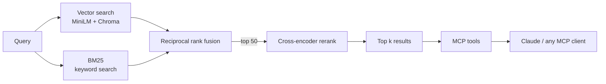

# catalog-search-mcp

**Hybrid product search over 43k messy real-world Wayfair listings, exposed as an MCP server so Claude (or any MCP client) can query it.**

BM25 + vector retrieval, fused with reciprocal rank fusion and reranked by a cross-encoder. Measured against 379 human-labeled queries from the [WANDS dataset](https://github.com/wayfair/WANDS).

---

## Results

| Method | Hit rate@10 | MRR@10 |
|---|---|---|
| Vector only (MiniLM, cosine) | 0.770 | 0.617 |
| Hybrid (BM25 + vector, RRF) | 0.863 | 0.699 |
| Rerank @20 candidates | 0.863 | 0.754 |
| Rerank @50 candidates (default) | 0.876 | 0.751 |
| **Rerank @100 candidates** | **0.879** | **0.754** |

- **Hit rate@10:** share of queries with at least one product a human labeled "Exact" in the top 10.
- **MRR@10:** how high the first correct product ranks (1.0 = always first).

Going from vector-only to rerank@50 raised hit rate by **10.6 points** and MRR by **22%**. Going from 50 to 100 candidates barely moves the needle, so 50 is the default.

### Latency (DGX, avg of 5 queries)

| Stage | Avg ms |
|---|---|
| Embed query | 2 |
| Vector search | 4 |
| BM25 | 44 |
| Rerank (top 50) | 92 |
| **Total** | **142** |

Rerank is ~65% of the cost, which is why the candidate count tradeoff matters. Measured with `python latency.py`.
### Tuning: how many candidates to rerank

| Candidates reranked | Hit rate@10 | MRR@10 |
|---|---|---|
| 20 | 0.863 | 0.753 |
| 50 (default) | 0.876 | 0.751 |

The reranker can only reorder what it's given, so fewer candidates lowers recall while barely changing ranking quality. That trades a little accuracy for faster responses.

---

## Demo: Claude using the tool

> **User:** Find me a gray dining set for 4 and tell me more about the top one.

Claude calls `search_products`, then `get_product`, and returns the **Mid-Century 5-Piece Wooden Dining Set (product 20748)**: the only indoor gray set for 4 in the results. It also flags a near-duplicate listing and noisy attributes in the source data.

---

## The problem

Real catalogs are messy, and customers search in vague, everyday language. Pure keyword search misses meaning ("sturdy outdoor bench that won't rust"). Pure vector search blurs exact names, brands, and attributes. This project combines both and proves the improvement with labeled evals rather than eyeballing results.

## The data

[WANDS](https://github.com/wayfair/WANDS) (Wayfair ANnotation DataSet): 42,994 products, 480 real customer queries, and human relevance labels.

What the cleanup found:

| Field | Missing | Handling |
|---|---|---|
| `product_description` | 6,008 (14%) | Fall back to name + features; flagged with `has_description` |
| `product_class` | 2,852 (6.6%) | Kept as-is (used as fallback for category) |
| `category hierarchy` | 1,556 (3.6%) | Filled from `product_class`, else `"Uncategorized"` |
| Ratings / review counts | 9,452 (22%) | Left empty, since "no reviews" isn't the same as a bad rating |

Other issues:
- **Feature strings** are one long `key:value|key:value` blob with empty keys, empty values, and repeats. These are parsed, deduped, and cleaned.
- **~40 "no" flags per product** (e.g. `murphybed: no`) were dropped, so a "murphy bed" query doesn't match beds that aren't murphy beds. Tradeoff: queries like "bed without drawers" lose that signal.
- **Variants merged into one listing**: one product can list several colors and sizes. Kept them all, since they help matching.
- **~400 shared product names** across distinct IDs (variants), so `product_id` is the unique key, not the name.

## Architecture



**MCP tools**
- `search_products(query, k)`: ranked products with name, category, and rating
- `get_product(product_id)`: full features and description

## Design decisions

- **Hybrid over vector-only:** BM25 catches exact names, brands, and attributes that embeddings blur. Adding it gave the single biggest gain.
- **RRF for fusion:** combines rankings without having to calibrate BM25 and cosine scores against each other.
- **Rerank only the top 50:** cross-encoders are accurate but slow. Running one on a shortlist keeps response times reasonable on a laptop with 8 GB of RAM.
- **Name and category first in the search text:** MiniLM reads only about 256 tokens, so the most informative fields go first.
- **Structured output, not raw text:** tools return clean fields so the assistant can reason and cite instead of parsing blobs.

## Known limitations and next steps

- Outdoor patio sets still appear for indoor queries. **Next:** extract category and attribute filters from the query.
- Long dimension fields use up the embedding's token budget. **Next:** reorder features so style, color, and material come before measurements.
- No price or stock data in WANDS. Results can't answer "under $500."
- **Next:** try stronger embedding models (e.g. `bge-small`), add latency numbers per stage, move to MCP SDK v2, and deploy a hosted endpoint.

## Run it

```bash
git clone https://github.com/keyur7523/catalog_search_mcp.git
cd catalog_search_mcp
python3 -m venv .venv && source .venv/bin/activate
pip install -r requirements.txt
git clone https://github.com/wayfair/WANDS.git data/WANDS

python ingest.py
python embed.py
python search.py gray dining set for 4

python run_eval.py --method vector
python run_eval.py --method hybrid
python run_eval.py --method rerank --candidates 50
python latency.py

**Connect to Claude Code:**
```bash
claude mcp add catalog-search -- $(pwd)/.venv/bin/python $(pwd)/mcp_server.py
```
Or test interactively with `mcp dev mcp_server.py` (MCP Inspector).

## Stack

Python · pandas · sentence-transformers (`all-MiniLM-L6-v2`, `ms-marco-MiniLM-L-6-v2`) · ChromaDB · rank_bm25 · MCP Python SDK
